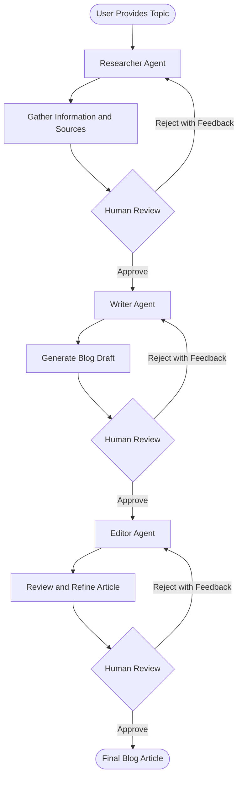
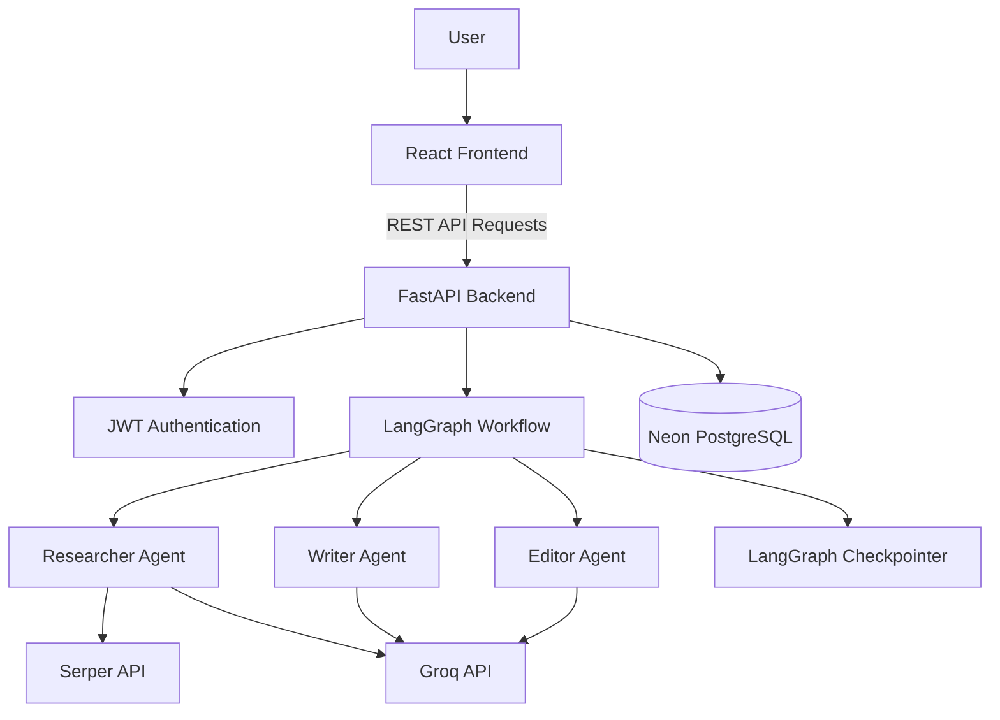

# ResearchFlow AI

### AI-Powered Blogging & Multi-Agent Research Platform

[](https://researchflowai.vercel.app)

**ResearchFlow AI** is an AI-powered research and blogging platform that uses a multi-agent architecture to transform a topic into a well-researched, structured, and polished blog article.

Instead of relying on a single AI model to generate an entire article, ResearchFlow AI uses specialized AI agents for research, writing, and editing. It also incorporates a Human-in-the-Loop (HITL) workflow, allowing users to review outputs, provide feedback, request revisions, and approve each stage before proceeding.

## Live Application

**Try ResearchFlow AI:** https://researchflowai.vercel.app

## Overview

Creating a high-quality blog requires more than generating text. It involves gathering relevant information, validating sources, organizing research, writing meaningful content, and reviewing the final article.

ResearchFlow AI simplifies this process through an intelligent multi-agent workflow powered by LangGraph.

Users provide a topic and select a blog type. The system then coordinates multiple specialized agents to generate the article through a structured process, with human approval at important stages.

## Key Features

- **Multi-Agent Architecture:** Uses specialized Researcher, Writer, and Editor agents to handle different stages of blog creation.
- **AI-Powered Research:** Integrates Google Search through Serper API to gather relevant information and supporting sources.
- **Automated Blog Generation:** Converts research into structured blog articles based on the selected blog type.
- **Human-in-the-Loop (HITL):** Allows users to review, approve, or reject outputs at each stage.
- **Feedback-Driven Revisions:** Users can provide feedback to improve research, drafts, and edited articles.
- **Conditional Workflow Routing:** LangGraph controls the execution flow based on user decisions.
- **Revision Management:** Tracks revision counts and applies configurable revision limits.
- **Source Validation:** The Editor agent uses source-checking functionality to help verify references.
- **Session Management:** Uses unique thread IDs to identify and resume individual workflow sessions.
- **REST API Backend:** Built with FastAPI to manage authentication, sessions, and workflow execution.

## How It Works

ResearchFlow AI follows a structured multi-agent workflow:



### Agent Responsibilities

**1. Researcher Agent**

- Understands the user's topic.
- Searches the web using the Serper API.
- Collects relevant information and supporting sources.
- Produces a structured research report.
- Incorporates feedback when research needs revision.

**2. Writer Agent**

- Takes the approved research report.
- Generates a structured blog article.
- Uses the selected blog type and writing requirements.
- Incorporates human feedback into subsequent drafts.

**3. Editor Agent**

- Reviews the generated blog draft.
- Improves clarity, readability, and structure.
- Checks source references using the available source-checking tool.
- Produces the final refined article.

### Human-in-the-Loop Workflow

Human approval is an important part of ResearchFlow AI.

At each review stage, users can:

- Approve the current output and proceed.
- Reject the output and provide feedback.
- Request revisions based on their requirements.

LangGraph's `interrupt()` mechanism pauses workflow execution until the user submits a decision. Checkpointing allows the workflow to resume using the same thread ID.

## Technology Stack

| Category | Technologies |
|---|---|
| Frontend | React, JavaScript |
| Backend | Python, FastAPI |
| Database | PostgreSQL (Neon) |
| ORM | SQLAlchemy |
| Data Validation | Pydantic |
| AI Models | Groq API |
| Agent Framework | LangChain |
| Workflow Orchestration | LangGraph |
| Web Search | Serper API |
| Authentication | JWT |
| Backend Deployment | Render |
| Frontend Deployment | Vercel |

## Architecture



## Getting Started

Follow these steps to run the project locally.

### Prerequisites

Make sure you have installed:

- Python 3.10 or higher
- Node.js and npm
- PostgreSQL database or Neon account
- Groq API key
- Serper API key
- Git

### 1. Clone the Repository

```bash
git clone YOUR_GITHUB_REPOSITORY_URL
cd ResearchFlow-AI
```

### 2. Backend Setup

Navigate to your backend directory:

```bash
cd backend
```

Create and activate a virtual environment:

**macOS / Linux**

```bash
python3 -m venv env
source env/bin/activate
```

**Windows**

```bash
python -m venv env
env\Scripts\activate
```

Install the dependencies:

```bash
pip install -r requirements.txt
```

Create a `.env` file in the appropriate backend configuration directory and configure your environment variables.

```env
DB_CONNECTION=your_postgresql_connection_string
SECRET_KEY=your_secret_key
ALGORITHM=HS256
ACCESS_TOKEN_EXPIRE_MINUTES=30

GROQ_API_KEY=your_groq_api_key
SERPER_API_KEY=your_serper_api_key
```

Use the actual variable names expected by your project configuration if they differ.

### 3. Run the Backend

From the directory containing your FastAPI application, run:

```bash
uvicorn main:app --reload
```

Backend API documentation:

```text
http://127.0.0.1:8000/docs
```

### 4. Frontend Setup

Open another terminal and navigate to the frontend directory:

```bash
cd frontend
```

Install dependencies:

```bash
npm install
```

Start the development server:

```bash
npm run dev
```

The frontend will be available at the local URL printed by Vite.

## API Overview

The backend exposes REST APIs for authentication, blog management, and AI workflow sessions.

| Endpoint | Method | Purpose |
|---|---|---|
| `/user/registration` | POST | Register a new user |
| `/user/login` | POST | Authenticate a user |
| `/blogs` | POST | Create a blog |
| `/blogs` | GET | Retrieve blogs |
| `/blogs/{blog_id}` | GET | Retrieve a specific blog |
| `/blogs/{blog_id}` | PUT | Update a blog |
| `/blogs/{blog_id}` | DELETE | Delete a blog |
| `/session/generate_response` | POST | Start an AI research workflow |
| `/session/{thread_id}/second_response` | POST | Submit human feedback or approval and resume the workflow |

*Note: Endpoint availability and request schemas depend on the deployed backend configuration.*

## Session Management and Checkpointing

ResearchFlow AI uses LangGraph thread IDs to maintain the identity of individual workflow sessions.

When a user starts a workflow:

1. The backend generates a unique thread ID.
2. LangGraph executes the workflow.
3. The workflow pauses at a human review stage.
4. The backend returns the thread ID and generated content.
5. The frontend sends the thread ID with the user's approval or feedback.
6. LangGraph retrieves the corresponding checkpoint and resumes execution.

This approach allows the application to maintain workflow progress across multiple API requests.

## Deployment

The application is deployed using:

- **Frontend:** Vercel
- **Backend:** Render
- **Database:** Neon PostgreSQL

Live application: https://researchflowai.vercel.app

## Future Improvements

Potential areas for further development include:

- Persistent LangGraph checkpoint storage using PostgreSQL.
- More advanced research and source-verification capabilities.
- Improved token usage and rate-limit management.
- Additional writing styles and blog templates.
- Exporting generated articles into PDF and DOCX formats.
- Enhanced conversational memory and workflow history.

## Contributing

Contributions, suggestions, and feedback are welcome.

1. Fork the repository.
2. Create a feature branch.
3. Commit your changes.
4. Push the branch.
5. Open a Pull Request.

## Author

**Abhishek Suresh**

Computer Science Engineering Student | AI & Backend Development

---

If you find ResearchFlow AI interesting, consider giving the repository a ⭐ on GitHub!

**Live Demo:** https://researchflowai.vercel.app
